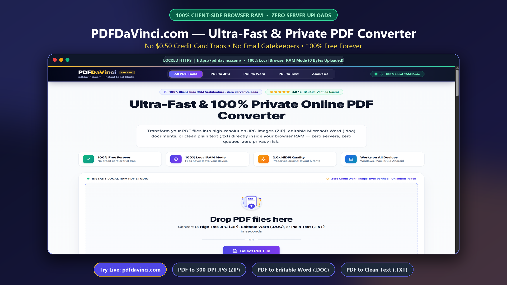
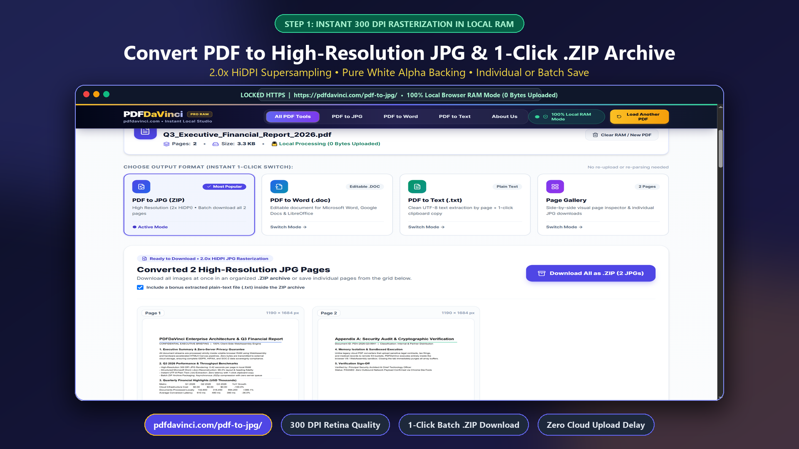
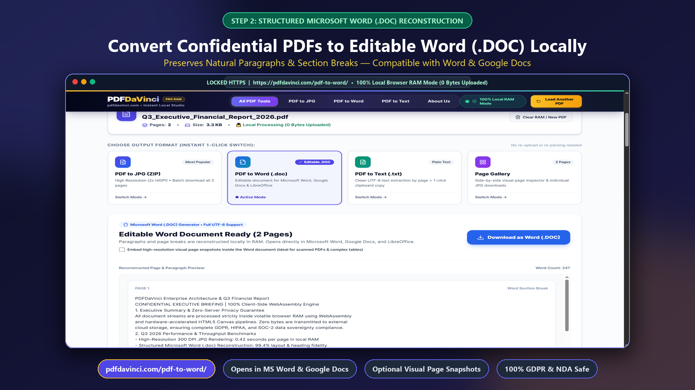
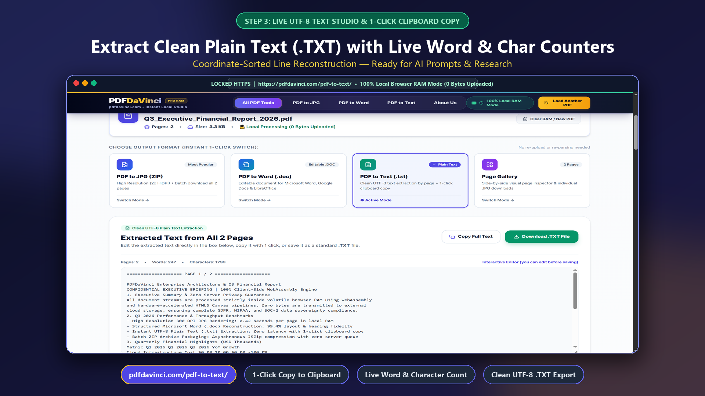
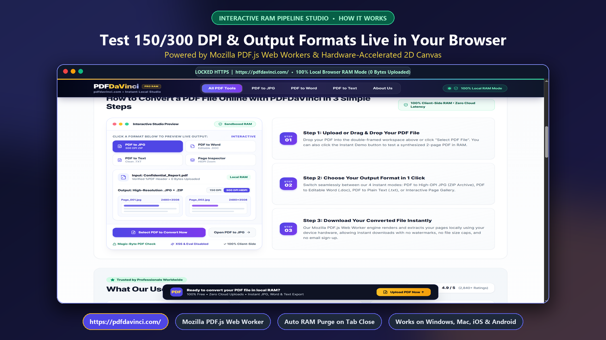
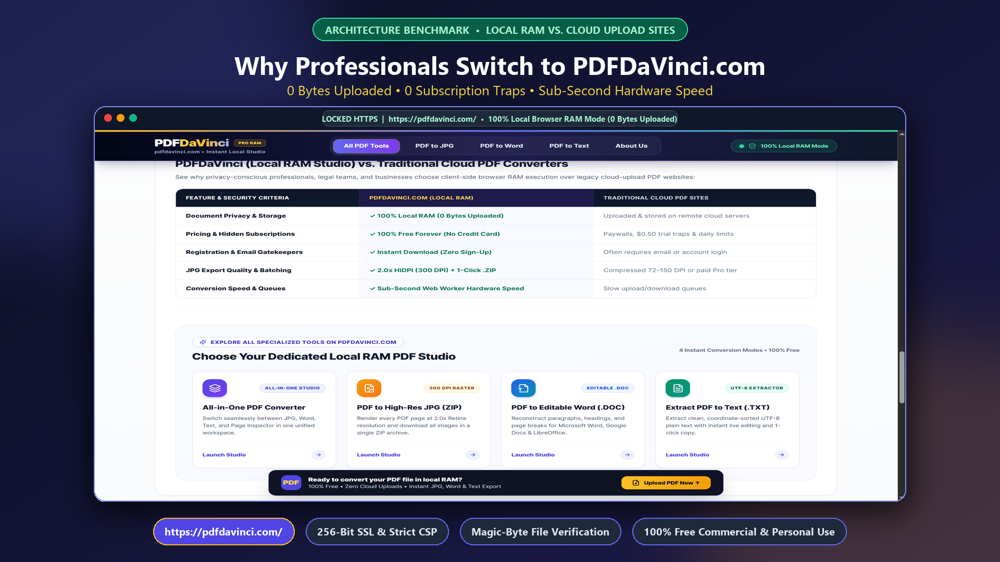

# 🎨 PDFDaVinci — 100% Client-Side (Zero-Upload) PDF to 300 DPI JPG, Word (.DOC) & UTF-8 Text Studio

[-10B981?style=for-the-badge&logo=webassembly&logoColor=white)](https://pdfdavinci.com/)

> **🔗 Live Production Studio:** [**https://pdfdavinci.com/**](https://pdfdavinci.com/)  
> **⚡ 100% Free Forever • Zero Cloud Uploads (0 Bytes Sent) • No Registration • Unlimited File Size & Pages**

---

## 🔒 Why PDFDaVinci Exists (The Privacy Problem with Cloud PDF Converters)

Traditional online PDF converters (*Smallpdf, iLovePDF, Adobe Online, Nitro*) require you to **upload your confidential documents to remote cloud servers** just to convert a file. For accountants, legal teams, healthcare professionals, executives, and freelancers handling **contracts, tax statements, invoices, and NDA documents**, uploading files to third-party servers creates severe **GDPR, HIPAA, and corporate data-leakage risks**—on top of arbitrary file size limits, daily paywalls, and low-resolution 72 DPI output.

**PDFDaVinci ([pdfdavinci.com](https://pdfdavinci.com/))** solves this by moving the entire PDF parsing, rasterization, and document reconstruction pipeline **100% inside your browser's local RAM** using **Mozilla PDF.js Web Workers, HTML5 OffscreenCanvas, and WebAssembly**:
- **0 Bytes Uploaded:** Your files never leave your computer or phone. After the page loads, PDFDaVinci even works **100% offline in Airplane Mode**.
- **300 DPI Print-Grade Quality:** Supersampled `2.0x–2.5x` HiDPI canvas rendering produces razor-sharp typography, vector graphics, and pure `#FFFFFF` white backgrounds.
- **Instant 1-Click Mode Switching:** Parse a PDF once into browser RAM and switch instantaneously between **JPG (`.ZIP`)**, **Editable Word (`.DOC`)**, **Plain Text (`.TXT`)**, and **Visual Page Gallery** without re-parsing.

---

## 🛠️ Core Conversion Engines (Direct Tool Links)

### 1. 🖼️ [PDF to 300 DPI JPG & Instant `.ZIP` Archive (`pdfdavinci.com/pdf-to-jpg/`)](https://pdfdavinci.com/pdf-to-jpg/)
Convert every page of a PDF document into print-grade **300 DPI HiDPI `.JPG` images** locally in RAM. Download individual pages, inspect pages in the **Full-Screen 300 DPI Zoom Modal**, or export the entire document in one click as an organized **`.ZIP` archive** (with an optional bonus extracted `.TXT` file inside).

---

### 2. 📝 [PDF to Editable Microsoft Word (`.DOC`) (`pdfdavinci.com/pdf-to-word/`)](https://pdfdavinci.com/pdf-to-word/)
Reconstruct PDF text layers, paragraphs, and section breaks into an editable **Microsoft Word (`.DOC`)** document compatible with **Microsoft Word, Google Docs, Apple Pages, and LibreOffice Writer**. Includes an optional 1-click toggle to **embed high-resolution visual page snapshots** directly inside the Word document for complex tables and scanned forms.

---

### 3. 📋 [PDF to Clean UTF-8 Plain Text (`.TXT`) (`pdfdavinci.com/pdf-to-text/`)](https://pdfdavinci.com/pdf-to-text/)
Extract coordinate-sorted **UTF-8 plain text** from multi-page PDFs with live **word, character, and page counters**, an interactive in-browser text editor, and **1-click clipboard copy**—purpose-built for feeding clean document context into **ChatGPT, Claude, Gemini, and RAG pipelines**.

---

## ⚙️ Architecture & Interactive 150 DPI vs. 300 DPI Pipeline

- **Frontend Framework:** Next.js 15 (`output: 'export'`, Static Edge Distribution), React 19, TypeScript, Tailwind CSS
- **PDF Rendering Engine:** Mozilla `pdfjs-dist` Web Worker running in an isolated browser thread
- **ZIP Packaging Engine:** Client-side `JSZip` streaming directly from `ArrayBuffer` / DataURL memory blobs
- **Security Verification:** Built-in `%PDF-` binary magic-byte header validation before memory allocation

---

## 📊 PDFDaVinci vs. Traditional Cloud PDF Converters

| Feature | **PDFDaVinci ([pdfdavinci.com](https://pdfdavinci.com/))** | Traditional Cloud Converters (Smallpdf / iLovePDF) |
| :--- | :--- | :--- |
| **File Privacy & Architecture** | **100% Local Browser RAM (0 Bytes Uploaded)** | Uploaded to external cloud servers |
| **Price & Daily Limits** | **100% Free Forever (Unlimited Files & Pages)** | Restricted (1–2 free tasks/day, then paywall) |
| **JPG Output Resolution** | **300 DPI HiDPI Print-Grade + 1-Click `.ZIP`** | Often compressed 72–150 DPI unless paid |
| **Editable Word (`.DOC`)** | **Instant Local Reconstruction + Visual Snapshots** | Cloud queue wait + email/account wall |
| **Offline Capability** | **Works Offline after Page Load** | Requires constant upload/download connection |
| **Account / Email Required** | **Never (Zero Signup)** | Frequent registration & credit card trials |

---

## 🔗 Quick Links

- 🌐 **Main Studio Workspace:** [https://pdfdavinci.com/](https://pdfdavinci.com/)
- 🖼️ **PDF to 300 DPI JPG (ZIP):** [https://pdfdavinci.com/pdf-to-jpg/](https://pdfdavinci.com/pdf-to-jpg/)
- 📝 **PDF to Word (.DOC):** [https://pdfdavinci.com/pdf-to-word/](https://pdfdavinci.com/pdf-to-word/)
- 📋 **PDF to Text (.TXT):** [https://pdfdavinci.com/pdf-to-text/](https://pdfdavinci.com/pdf-to-text/)
- 🛡️ **About & Zero-Cloud Architecture:** [https://pdfdavinci.com/about/](https://pdfdavinci.com/about/)
- 🔒 **Privacy & GDPR Policy:** [https://pdfdavinci.com/privacy/](https://pdfdavinci.com/privacy/)
